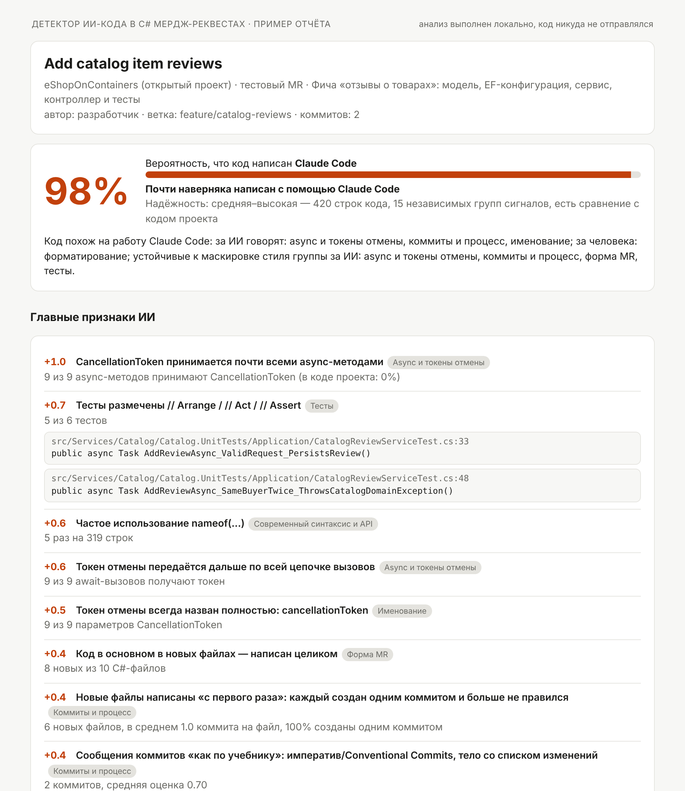
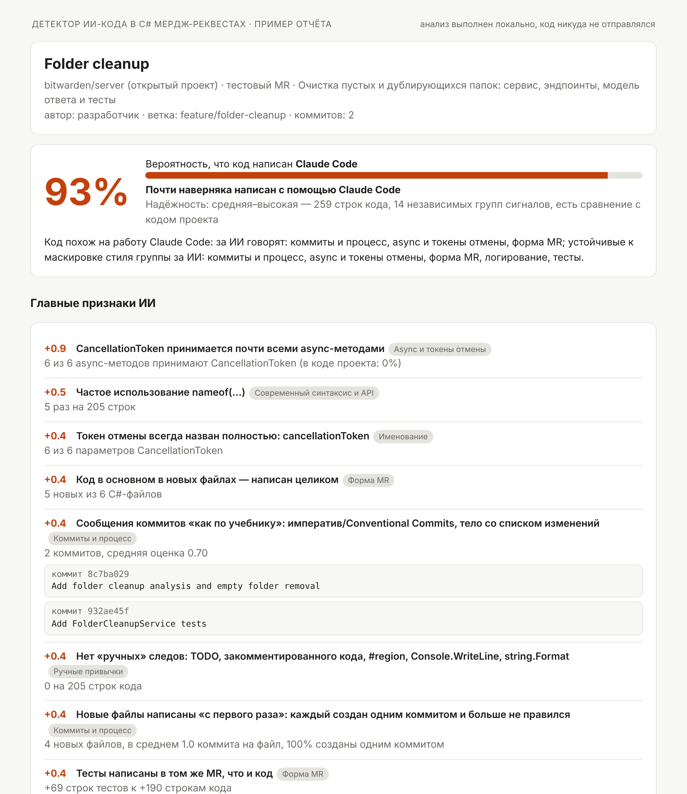
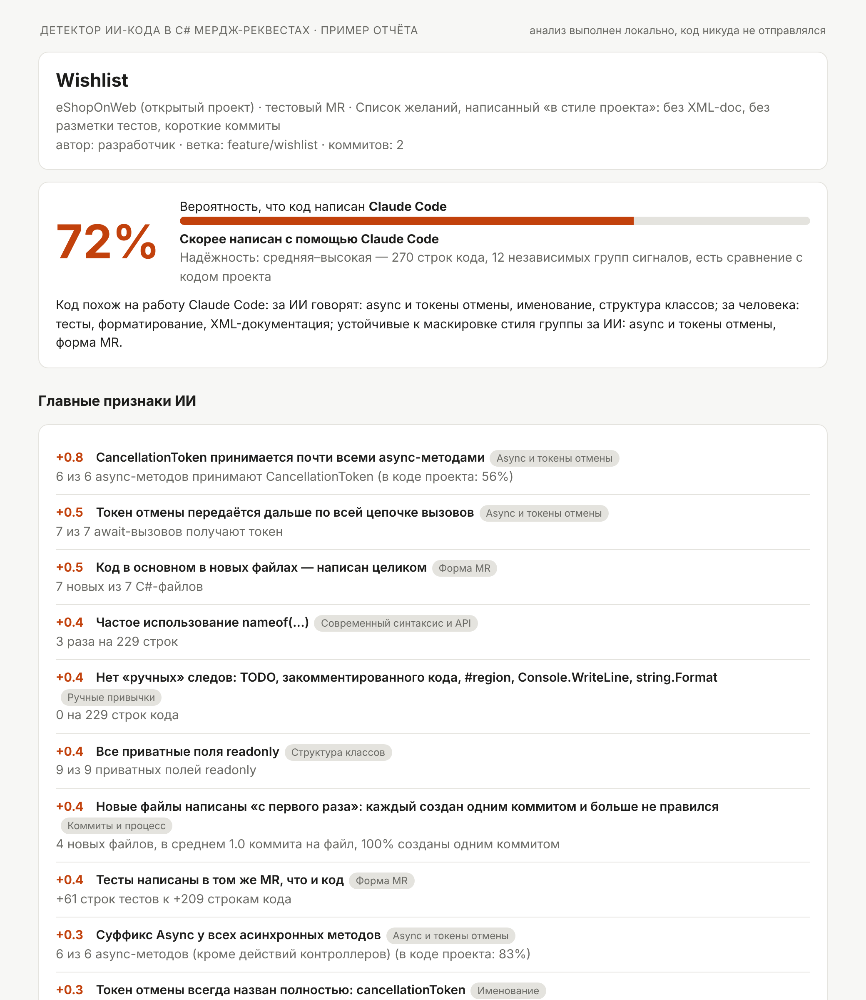

# DetectAICodeTest: кто написал мердж-реквест — человек или Claude Code

Программа получает ссылку на MR в GitLab и выдаёт **вероятность (в %) того, что код написан Claude Code**. Вместе с ней — **объяснение**: какие паттерны ИИ найдены, какие признаки указывают на человека и какой вклад дала каждая группа сигналов. В отчёте указан **стек проекта**.

**Языки:**

| Язык | Что анализируется | Исследование |
|---|---|---|
| **C# (.NET)** | `.cs`, разбор Roslyn | [docs/RESEARCH.md](docs/RESEARCH.md) |
| **JavaScript / TypeScript (фронтенд)** | React, Angular, Vue: `.ts/.tsx/.js/.jsx/.vue`, шаблоны Angular `.html`, стили `.css/.scss/.less`; собственный разбор на C# | [docs/frontend/RESEARCH.md](docs/frontend/RESEARCH.md) |

Язык выбирается на странице сразу после ссылки на MR («C#», «JavaScript / TypeScript» или «Авто» — по файлам MR), в консоли — флагом `--lang csharp|frontend|auto`.

Анализ полностью **локальный**: код MR никуда, кроме вашего GitLab, не отправляется. Внешних ИИ-сервисов нет, Node.js не нужен.

## Быстрый старт

Нужны только интернет (при первом запуске) и токен GitLab. .NET ставить не надо: скрипт запуска сам скачает .NET SDK 10 в папку пользователя (без прав администратора, около 200 МБ) и соберёт программу. Последующие запуски занимают секунды.

Скачать проект: `git clone https://github.com/vvvq3/DetectAICodeTest.git` (папка `DetectAICodeTest`) или без git — [ZIP-архив](https://github.com/vvvq3/DetectAICodeTest/archive/refs/heads/claude/inspiring-lamport-i2ixa7.zip) (распаковать в любую папку; она будет называться `DetectAICodeTest-claude-inspiring-lamport-i2ixa7`). Дальше все команды выполняются из папки проекта.

### macOS (Терминал)

```bash
cd ~/Downloads/DetectAICodeTest          # ваша папка проекта
export GITLAB_TOKEN=glpat-xxxxxxxxxxxxxxxx
bash run.sh https://gitlab.company.com/group/project/-/merge_requests/123
```

- Веб-страница с полем для ссылки и выбором языка: `bash run.sh web` (откроется http://127.0.0.1:5057).
  - Токен вводится один раз и хранится, пока открыта вкладка.
  - Выбранный язык и галочка «только по коду» запоминаются.
  - После каждой проверки поле ссылки очищается, а проверенные MR собираются в список на странице (с отметкой языка).
- Фронтенд-MR из консоли: `bash run.sh <ссылка> --lang frontend` (без флага язык определяется автоматически).
- Несколько MR сразу (файл со ссылками, по одной в строке): `bash run.sh batch mrs.txt --html reports/`.

### Windows (PowerShell)

```powershell
cd $HOME\Downloads\DetectAICodeTest       # ваша папка проекта
$env:GITLAB_TOKEN = "glpat-xxxxxxxxxxxxxxxx"
.\run.cmd https://gitlab.company.com/group/project/-/merge_requests/123
```

- Веб-страница: `.\run.cmd web`.
- Несколько MR: `.\run.cmd batch mrs.txt --html reports\`.
- В обычной командной строке (cmd) токен задаётся командой `set GITLAB_TOKEN=glpat-...`.
- `run.cmd` сам запускает PowerShell-скрипт `run.ps1` в обход политики выполнения, менять настройки Windows не нужно.

При первой сборке скачиваются пакеты с nuget.org (Roslyn, DiffPlex). За корпоративным прокси задайте `HTTPS_PROXY`. Если .NET SDK 10+ уже установлен, используется он.

### Как дать доступ к веб-версии коллегам

Программа работает на вашем компьютере, коллеги открывают её страницу у себя в браузере. Каждый вводит свой токен GitLab: один раз, он хранится только в его вкладке.

**Коллеги в той же сети или VPN, что и вы:**

```bash
bash run.sh web --host 0.0.0.0 --password придумайте-пароль --gitlab-host gitlab.company.com
```

В Терминале появится строка `для коллег в вашей сети: http://192.168.x.x:5057/`, эту ссылку и пароль отправьте коллегам. Имя пользователя при входе любое. Если macOS спросит «Разрешить входящие подключения для dotnet?», нажмите «Разрешить».

**Коллеги вне вашей сети** — публичная https-ссылка одной командой:

```bash
bash share.sh gitlab.company.com
```

Скрипт сам скачает `cloudflared` (бесплатный туннель Cloudflare, без регистрации и без brew), придумает пароль и запустит детектор. Ссылку `https://….trycloudflare.com` он напечатает только после того, как туннель реально подключится. Ссылка, пароль и готовое сообщение для коллег копируются в буфер обмена. Ссылка работает, пока открыто окно Терминала, и всё это время Мак не уснёт. Остановить — Ctrl+C. При следующем запуске ссылка будет новой. Свой пароль можно задать вторым параметром: `bash share.sh gitlab.company.com МойПароль`.

Безопасность при общем доступе:
- **Всегда задавайте `--password`.** Без пароля проверять MR через ваш компьютер сможет любой, кто знает ссылку.
- **`--gitlab-host`** разрешает проверять только MR с вашего GitLab. Без него страницу можно использовать для запросов к любым адресам, доступным с вашего компьютера.
- **Не задавайте `GITLAB_TOKEN`** перед общим запуском. Иначе все, у кого есть ссылка и пароль, будут проверять MR с вашими правами в GitLab и увидят фрагменты кода, доступные вам.
- Пока страница доступна другим, ваш компьютер должен быть включён и не спать.
- Через туннель весь трафик страницы (токены коллег и отчёты с фрагментами кода) проходит через серверы Cloudflare. Если это недопустимо по правилам компании, используйте вариант с общей сетью или VPN.

### Токен GitLab
GitLab → аватар → **Edit profile → Access Tokens** → *Add new token*, scope **`read_api`** (достаточно; `read_repository` не нужен). Токен передаётся через переменную `GITLAB_TOKEN` или параметр `--token`.

Для собственного сервера:
- самоподписанный сертификат — флаг `--insecure` (или `GITLAB_INSECURE=1`);
- GitLab в подкаталоге (`https://host/gitlab/...`) — `--api-url https://host/gitlab/api/v4`;
- сервер за VPN — достаточно, чтобы VPN был включён на компьютере.

## Примеры отчётов

Три MR из тестового корпуса, написанные Claude Code в открытых проектах ([PDF со всеми тремя](docs/examples/examples.pdf), HTML-версии — в [docs/examples](docs/examples)):

| eShopOnContainers — 98% | bitwarden/server — 93% | eShopOnWeb, «в стиле проекта» — 72% |
|---|---|---|
|  |  |  |

## Что показывает отчёт

```
  Вероятность, что код написан Claude Code: 96%  █████████████████████████████░
  Вердикт: Почти наверняка написан с помощью Claude Code
  Надёжность оценки: средняя–высокая — 307 строк кода, 14 независимых групп сигналов, есть сравнение с кодом проекта

  Код похож на работу Claude Code: за ИИ говорят: тесты, форма MR, async и токены
  отмены; устойчивые к маскировке стиля группы за ИИ: async и токены отмены, форма MR, тесты.

  Главные признаки ИИ:
    +1.0  CancellationToken принимается почти всеми async-методами  [Async и токены отмены]
          9 из 9 async-методов принимают CancellationToken (в коде проекта: 0%)
    +0.7  Тесты размечены // Arrange / // Act / // Assert  [Тесты]
          6 из 6 тестов (в коде проекта: 0%)
          OrderTests/OrderCancel.cs:12  [Fact]
    +0.6  Структурное логирование: шаблоны {OrderId} вместо интерполяции  [Логирование]
          OrderEndpoints/Cancel.cs:54  _logger.LogWarning(ex, "Failed to cancel order {OrderId}", request.OrderId);
    ...
  Признаки человека:
    -0.8  «Ручные» следы в коде  [Ручные привычки]
          TODO/FIXME/HACK: 1; закомментированный код: 1; склейка строк через +: 2
  Файлы (оценка только по коду, самые «ИИ-подобные» сверху):
     83%  Services/CatalogReviewService.cs     +107  CancellationToken принимается почти всеми async-методами; …
     61%  Controllers/CatalogReviewsController.cs  +72  …
  Вклад групп сигналов (в логитах; ▲ — за ИИ, ▼ — за человека):
    Форма MR                        +1.1  ▲▲ (устойчив к маскировке)
    Async и токены отмены           +1.0  ▲▲ (устойчив к маскировке)
    ...
```

- **Вероятность** — итоговая оценка с учётом всех групп сигналов.
- **Вердикт:**
  - ≥ 85% — «почти наверняка Claude»;
  - 65–85% — «скорее Claude»;
  - 35–65% — «неопределённо»;
  - ниже — «скорее/почти наверняка человек».
- **Надёжность** зависит от объёма кода, числа сработавших групп и наличия сравнения с кодом проекта.
- Число у признака — его вклад в итоговый логит: плюс тянет к ИИ, минус к человеку.
- Пометка «устойчив к маскировке» стоит у групп, которые по исследованию не убираются инструкцией «пиши как в проекте»: корректность, форма MR, процесс.
- Если найдены прямые следы (трейлер `Co-Authored-By: Claude` и т.п.), дополнительно показывается вероятность **без них**, только по коду.
- Короткий абзац под вердиктом объясняет решение обычным языком: какие группы сигналов перевесили и какие из них устойчивы к маскировке.
- Таблица **«Файлы»** показывает, какие файлы MR больше всего похожи на ИИ (оценка по коду каждого файла отдельно).
- Если в репозитории найдены конвенции (StyleCop, обязательный XML-doc, `.editorconfig` со стилевыми правилами, commitlint, шаблон описания MR), отчёт об этом сообщает. Соответствующие признаки ослабляются, потому что их соблюдают все, включая людей.

## Как работает

```
GitLab API ─► MR, коммиты, диффы, файлы до/после, соседние файлы проекта, конфиги (csproj, package.json, ESLint, Prettier, tsconfig…)
           ─► выбор языка (или автоопределение по добавленным строкам)
           ─► детектор языка: без сгенерированного кода, разбор (Roslyn для C#, свой лексер и мини-парсер для JS/TS/JSX/Vue/Angular/CSS),
              область анализа = добавленные строки ─► признаки кода, поправка на стиль и конвенции проекта
           ─► общие сигналы MR: прямые следы Claude Code, форма MR, коммиты и процесс
           ─► сумма вкладов с ограничением каждой группы ─► вероятность + объяснение + стек
```

### C# (.NET)

| Группа | Примеры признаков |
|---|---|
| Прямые следы | `Co-Authored-By: Claude`, «Generated with Claude Code», ссылка `claude.ai/code/session_…`, `CLAUDE.md`/`.claude/` в MR или репозитории, ветка `claude/…`, описание `## Summary` + `## Test plan` |
| XML-документация | доля публичных членов с XML-doc, полнота `<param>`/`<returns>`, шаблонные фразы («Gets or sets…», «A token to cancel…»), `<inheritdoc />`, `<exception cref>` |
| Комментарии | пошаговые «повествования» (`// Validate…`, `// Получаем…`), пересказ следующей строки, нумерованные шаги, язык (небрежный русский — человек; английский при русском проекте — ИИ), регистр |
| Именование | длина имён, короткие имена, сокращения (`ct`, `cfg`, `res`…), «агентские» имена (`result`, `existing…`, `normalized…`), `cancellationToken` полностью, лямбды `x =>`, **транслит/кириллица** в идентификаторах (`zakaz`, `kolvo`), венгерская нотация (`strName`, `m_field`) |
| Современный синтаксис и API | `is null`, file-scoped namespace, `[]`, `new()`, switch-выражения, `record`, `required`, primary ctor, `IsNullOrWhiteSpace`, `string.Empty`, `= string.Empty` у свойств, `IReadOnlyList`, `UtcNow` против `Now`, `StringComparison`, `nameof` |
| Защитный код | guard-клаузы в публичных методах, `ThrowIfNull`, `Guard.Against`, `?? throw new ArgumentNullException` |
| Async | `CancellationToken` в async-методах, передача токена дальше, `= default`, суффикс `Async`, `ConfigureAwait(false)`; анти-паттерны `.Result`, `.Wait()`, `async void` |
| Логирование | шаблоны `{OrderId}` против `$"…"`/конкатенации, плотность логов |
| Исключения | сообщения-предложения с точкой, `'{value}'` в кавычках, конкретные типы против `new Exception`, `catch (Exception e)`, `throw ex;`, пустой `catch {}` |
| Структура и идиомы агента | `sealed`, `readonly`, порядок членов, явные модификаторы доступа, длинные/вложенные/запутанные методы, публичные поля, эмодзи в строках, `const string SectionName`, `[ProducesResponseType]` на каждом действии, `AsNoTracking()`, константы против «магических чисел» |
| Ручные привычки | TODO/FIXME, ссылки на тикеты, закомментированный код, `#region`, `Console.WriteLine`, `string.Format`, склейка через `+`, LINQ query-синтаксис, `Thread.Sleep`, опечатки |
| Форматирование | пробелы в конце строк, `if(`, `x=y`, `){`, `//комментарий` без пробела, двойные пустые строки, K&R-скобки, табы, длинные строки |
| Тесты | `// Arrange / Act / Assert`, имена `Method_Scenario_Expected`, `[Theory]`+`[InlineData]`, `test@example.com` |
| Форма MR | число затронутых слоёв, тесты в том же MR и их доля, новые `.md`, доля новых файлов, «полная архитектура» (интерфейс + реализация + DI + options), единообразие стиля по файлам |
| Коммиты и процесс | стиль сообщений (Conventional Commits, тело-список), коммиты-доделки «fix/правки», **скорость** (строк в час между коммитами одного автора, по дате авторства — устойчиво к rebase), **«готовность с первого раза»** (новый файл создан одним коммитом), **реакция на ревью** (скорость и ширина исправлений после замечаний), описание MR, упоминание ИИ-инструментов, эмодзи в коммитах |
| Отличие от стиля проекта | те же признаки на существующем коде проекта (старые версии файлов + соседние файлы): MR «аккуратнее» проекта → ИИ; конвенции проекта (XML-doc по StyleCop и т.п.) ослабляют соответствующие признаки |

Подробности и обоснование — в [docs/RESEARCH.md](docs/RESEARCH.md), код — в [`src/AiDetect.Languages.CSharp`](src/AiDetect.Languages.CSharp).

### JavaScript / TypeScript (фронтенд)

| Группа | Примеры признаков |
|---|---|
| Прямые следы, форма MR, процесс | общие с C#; плюс «комплект» компонента (типы, константы, хуки, `index.ts`, тесты, сторис), barrel-файлы |
| JSDoc/TSDoc | JSDoc на экспортах и публичных методах, шаблонные фразы («Returns…», «Custom hook that…»), документированные поля `…Props`, `@param {Type}` в TS (человек) |
| Комментарии | повествования («// Fetch users»), пересказ кода, заголовки секций разметки `{/* Header */}` и стилей, небрежные комментарии, язык комментариев |
| Именование | `catch (error)` против `catch (e)`, `users.map((user) =>` против `x =>`, сокращения, `handleX`, префикс `I` у интерфейсов, транслит |
| Типизация TypeScript | `any`, `unknown`, `!`, `as`, `as const`, служебные типы, объединения литералов против `enum`, явные типы результата, `useState<T>(null)`, `import type` |
| Современный синтаксис | `??`, `?.`, `===`, `const`/`let`/`var`, шаблонные строки против `+`, `async/await` против `.then()`, функциональные обновления состояния |
| Обработка ошибок | `error instanceof Error ? … : 'Unknown error'`, проверка `response.ok`, сообщения «Failed to…», тройка loading/error/finally; пустой `catch`, `throw 'строка'` |
| Отмена и отписка | очистка в `useEffect`, `AbortController`, флаг `cancelled`; Angular: `takeUntil`/`takeUntilDestroyed`/`unsubscribe`, `| async`; Vue: `onUnmounted` |
| Логирование | `console.error('Failed to load users:', error)` против `console.log` |
| Идиомы фреймворков | React: мемоизация, свои хуки, `key={index}`, `React.FC`, классы и PropTypes; Angular: `private readonly` в DI, `subscribe({ next, error })`, вложенные `subscribe`, `http.get<T>`, `trackBy`, `OnPush`; Vue: `defineProps<…>()`, `withDefaults`, Options API, `v-for` без ключа |
| Разметка и доступность | `type="button"`, `aria-*`, `data-testid`, `label for`, `alt`, клики на `div` |
| Стили | CSS-переменные, «типовые» значения ИИ (`rgba(0,0,0,0.1)`, `0.2s ease`, палитра Tailwind), `:focus-visible`, `!important`, `z-index: 9999`, вендорные префиксы |
| Ручные привычки и форматирование | TODO, закомментированный код, `debugger`, `eslint-disable`, `@ts-ignore`, `alert`, jQuery, опечатки; пробелы в конце строк, `if(`, смешение кавычек и `;` |
| Тесты | `should …`, `it.each`, `clearAllMocks`, `getByRole`, `userEvent`, точные проверки, `test@example.com`, AAA; снапшоты (человек) |

Конвенции проекта ищутся в конфигах без запуска Node.js: Prettier, правила и пресеты ESLint/TSLint (airbnb, @typescript-eslint, jsx-a11y, angular-eslint, vue), строгий tsconfig, stylelint, husky/lint-staged. Правило, которое делает черту обязательной для всех, ослабляет соответствующий признак. Подробности — [docs/frontend/RESEARCH.md](docs/frontend/RESEARCH.md), код — [`src/AiDetect.Languages.Frontend`](src/AiDetect.Languages.Frontend).

## Проверка качества

Корпус: 121 настоящий MR из 19 публичных C#-проектов **до 2021 года** (заведомо человеческий код: eShopOnContainers, eShopOnWeb, jellyfin, bitwarden/server, nopCommerce, Polly, AutoMapper, Squidex, IdentityServer4, Sonarr и др.) против 19 MR, написанных Claude в тех же репозиториях. ИИ-MR — в обычном режиме и в «замаскированном» (стиль проекта, без XML-doc, русские комментарии, «очеловеченный»).

| | ROC AUC | Точность | Ложные «ИИ» на коде людей | Найдено ИИ |
|---|---|---|---|---|
| Перекрёстная проверка (честная оценка) | 0.955 | 95% | 2% | 79% |
| Claude в обычном режиме против людей | 0.995 | 98% | 2% | 100% |
| Claude с маскировкой против людей | 0.90 | 95% | 2% | 43% |

Ни один из 121 человеческого MR не получил ≥ 65%. Подробнее — в [docs/EVALUATION.md](docs/EVALUATION.md).

Повторить проверку:

```bash
scripts/build_corpus_from_git.py --repo <путь к клону> --name <имя> --out corpus/human --before 2021-01-01 --max 8
./run.sh eval corpus -v
```

## Настройка под вашу команду (рекомендуется)

Веса признаков — экспертные, из исследования, с поправкой на публичный корпус. Чтобы подстроить детектор под вашу кодовую базу, разметьте 20–50 своих MR:

```bash
./run.sh fetch https://gitlab.company.com/.../merge_requests/101 --save corpus-my/human/mr101.json
./run.sh fetch https://gitlab.company.com/.../merge_requests/202 --save corpus-my/ai/mr202.json
./run.sh eval corpus-my -v                       # точность на ваших MR и какие признаки различают
./run.sh calibrate corpus-my --lang csharp -o model/weights.csharp.json   # подбор весов (с перекрёстной проверкой)
```

Веса хранятся отдельно для каждого языка: `model/weights.csharp.json`, `model/weights.frontend.json`. Они подхватываются автоматически при следующей сборке.

## Другие режимы

```bash
./run.sh <ссылка> --html report.html        # HTML-отчёт
./run.sh <ссылка> --json                     # JSON для интеграций
./run.sh <ссылка> -v                         # все сработавшие признаки с примерами
./run.sh <ссылка> --no-artifacts             # только по коду (без трейлеров и CLAUDE.md)
./run.sh <ссылка> --save mr.json             # сохранить MR, потом: ./run.sh --load mr.json
./run.sh --git ~/src/project --base main --head feature/x   # локальная ветка без GitLab
scripts/make-demo-repo.sh /tmp/demo && ./run.sh --git /tmp/demo --base main --head feature/ai-discounts
```

## Ограничения (честно)

- Результат — **вероятностная оценка, не доказательство**. Исследование прямо предупреждает: не использовать его как единственное основание для кадровых решений.
- Сильная маскировка (инструкция «пиши как в проекте» + ручная доработка) снижает уверенность до зоны «неопределённо». Устойчивее всего группы async/логирование, форма MR и процесс.
- Сеньоры с очень чистым стилем, а также команды со строгими анализаторами выглядят «аккуратнее среднего». Сравнение с кодом проекта и учёт конвенций это частично компенсируют, лучше всего помогает калибровка на своих MR.
- Корпус ИИ-примеров сгенерирован Claude по задачам в публичных репозиториях. Он меньше реального разнообразия, поэтому калибровка на ваших MR даст заметный прирост.
- MR меньше ~60 строк C# анализируются плохо (по исследованию надёжность текстового анализа начинается с 2–3 тыс. символов).

## Структура

Один репозиторий и одна основная ветка для всех языков: детекторы используют общее ядро и одну веб-страницу. Каждый язык — отдельный модуль.

```
src/AiDetect.Core/                 общее ядро: модель MR, источники (GitLab/git/JSON), дифф, сигналы MR и процесса,
                                   скоринг, калибровка, отчёты; интерфейс ILanguageAnalyzer и реестр языков
src/AiDetect.Languages.CSharp/     детектор C# (Roslyn)
src/AiDetect.Languages.Frontend/   детектор JS/TS: Parsing/ (лексер, Vue, HTML, CSS), признаки, сигналы, конвенции, стек
src/AiDetect.Cli/                  консоль и веб-режим (aidetect), список языков — AppLanguages.cs
tests/AiDetect.Tests/              тесты ядра и C#
tests/AiDetect.Frontend.Tests/     тесты фронтенда
tests/web/                         поддельный GitLab и браузерные тесты страницы
model/weights.<язык>.json          веса моделей
corpus/<язык>/                     манифесты корпуса и патчи ИИ-образцов (JSON пересобираются scripts/rebuild_corpus.py)
docs/                              CONTEXT.md (конспект проекта), исследование и оценка C#; docs/frontend/ — то же для фронтенда
scripts/                           отбор и пересборка корпуса, экспорт ИИ-образцов, оценка, примеры
```

### Как добавить новый язык

1. Создать проект `src/AiDetect.Languages.<Язык>` с реализацией `ILanguageAnalyzer`:
   - какие файлы анализировать;
   - извлечение признаков и сигналы по коду;
   - слои, конвенции, стек.
2. Добавить строку в `src/AiDetect.Cli/AppLanguages.cs`. Пункт на странице и флаг `--lang` появятся сами.
3. Собрать корпус `corpus/<язык>/`:
   - `scripts/select_corpus_commits.py` — человеческие MR;
   - агенты и `scripts/export_ai_samples.py` — ИИ-образцы;
   - `scripts/rebuild_corpus.py` — пересборка.
4. Откалибровать: `scripts/evaluate.sh <язык>` → `model/weights.<язык>.json`.

### Версии и ветки

- **`v1`** (тег `v1.0.0`) — только C#.
- **`v2`** (тег `v2.0.0`) — C# + фронтенд.
- Основная линия разработки — ветка по умолчанию. Новые языки и задачи делаются в коротких рабочих ветках и вливаются в основную. Отдельные ветки под языки не нужны.
- История версий — [CHANGELOG.md](CHANGELOG.md).
